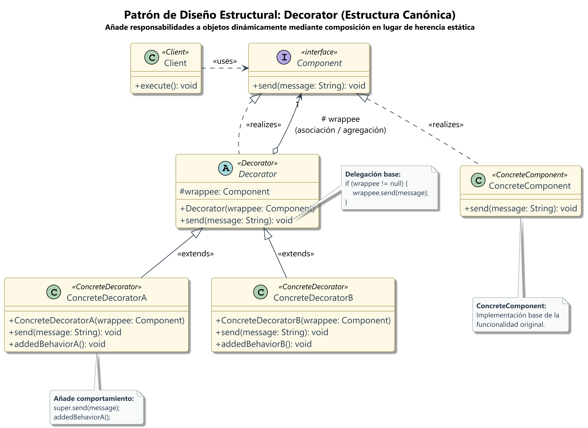
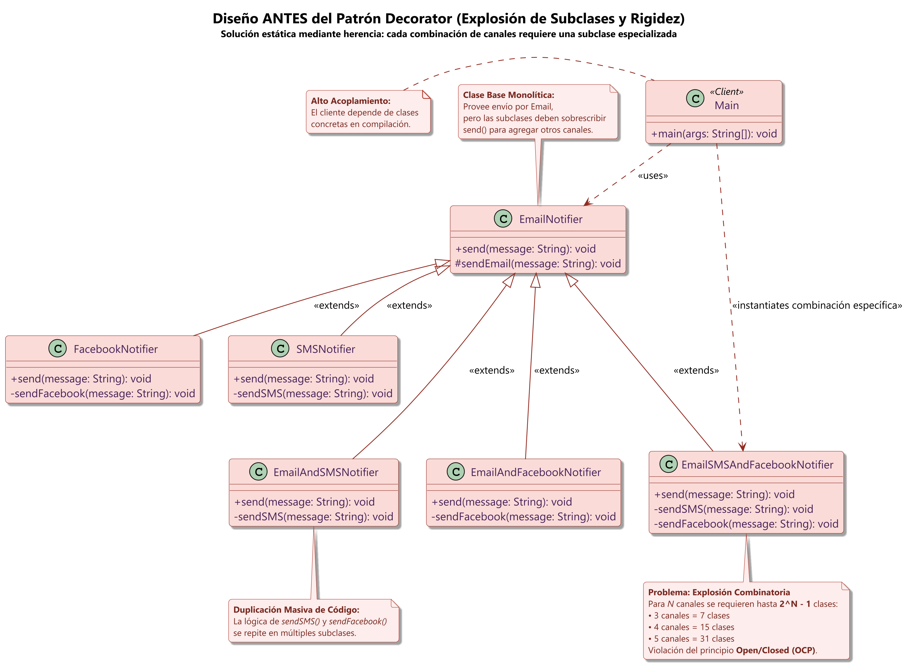
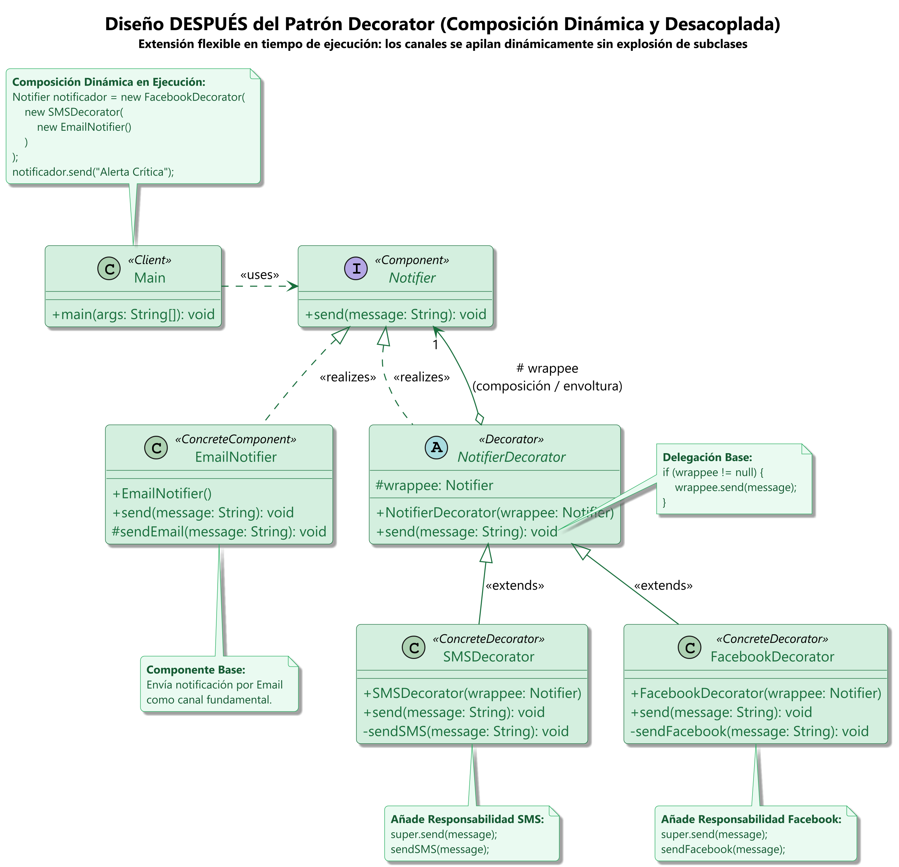

# patron-decorator-java

---

## 📚 Tabla de contenidos

1. [Nombre del proyecto](#nombre-del-proyecto)
2. [Objetivo académico](#objetivo-académico)
3. [¿Qué es el patrón Decorator?](#qué-es-el-patrón-decorator)
4. [Problema que se pretende resolver](#problema-que-se-pretiende-resolver)
5. [Arquitectura y participantes del patrón](#arquitectura-y-participantes-del-patrón)
6. [Estructura de carpetas](#estructura-de-carpetas)
7. [Requisitos de instalación](#requisitos-de-instalación)
8. [Cómo compilar y ejecutar](#cómo-compilar-y‑ejecutar)
9. [Ejemplo de salida real](#ejemplo-de‑salida‑real)
10. [Comparación técnica: antes vs. después](#comparación-técnica‑antes‑vs‑después)
11. [Diagramas UML](#diagramas-uml)
12. [Pruebas automatizadas](#pruebas-automatizadas)
13. [Conclusiones](#conclusiones)
14. [Referencias bibliográficas](#referencias-bibliográficas)

---

## Nombre del proyecto

**patron-decorator-java** – Implementación académica del **Patrón de Diseño estructural Decorator** en Java 21, basada en un sistema de notificaciones por **Email**, **SMS** y **Facebook**.

---

## Objetivo académico

- Mostrar, mediante un mismo caso de uso, la **diferencia entre una arquitectura sin Decorator** (clases concretas para cada combinación de canales) y una **arquitectura refactorizada que aplica correctamente el patrón Decorator**.
- Analizar el impacto en **acoplamiento, extensibilidad y mantenibilidad**.
- Proveer código ejecutable, pruebas unitarias y diagramas UML listos para una presentación universitaria y para el repositorio de GitHub.

---

## ¿Qué es el patrón Decorator?

El **Patrón Decorator** es un patrón estructural que permite **añadir comportamiento a objetos de forma dinámica** sin modificar su código fuente ni crear jerarquías de herencia extensas. Se basa en:

- Una **interfaz común** (`Notifier`).
- **Composición**: cada decorador mantiene una referencia al objeto que envuelve.
- **Delegación**: el decorador delega la operación original y luego ejecuta su propio comportamiento.
- **Encadenamiento**: varios decoradores pueden apilarse, creando combinaciones arbitrarias de responsabilidades.

Fuente: <https://refactoring.guru/es/design-patterns/decorator>

---

## Problema que se pretende resolver

En el escenario de notificaciones existen **tres canales** (Email, SMS, Facebook).  Sin Decorator, cada combinación no vacía requiere una clase distinta.  Con tres canales, esto genera **7 clases concretas** (`EmailNotifier`, `SMSNotifier`, `FacebookNotifier`, `EmailAndSMSNotifier`, `EmailAndFacebookNotifier`, `SMSAndFacebookNotifier`, `EmailSMSAndFacebookNotifier`).

Problemas de esta aproximación:

| Aspecto | Sin Decorator | Con Decorator |
|---------|--------------|---------------|
| **Número de clases** | 7 (más potencialmente 2³‑1) | 3 (interfaz + implementación base + decoradores) |
| **Acoplamiento** | Cada clase conoce directamente los otros canales que combina. | Cada decorador conoce solo el canal que añade y delega al resto. |
| **Extensibilidad** | Añadir un nuevo canal implica crear **n** nuevas combinaciones. | Sólo se crea **un nuevo decorador**; el resto del código permanece intacto. |
| **Reutilización de código** | Código de envío duplicado en varias clases. | Código de envío de cada canal está centralizado en su decorador. |
| **Mantenimiento** | Cambios en la lógica de un canal deben replicarse en todas las combinaciones. | Cambios en un canal se hacen en su decorador único. |
| **Complejidad** | Crecimiento exponencial del número de clases. | Crecimiento lineal con el número de canales. |

---

## Arquitectura y participantes del patrón

### Módulo **after‑decorator**

| Clase | Responsabilidad |
|------|------------------|
| `Notifier` (interfaz) | Define el método `void send(String message);`. |
| `EmailNotifier` | Implementación base que envía el mensaje por email (`[Email] Enviando: …`). |
| `NotifierDecorator` (abstracta) | Mantiene una referencia a otro `Notifier` y delega la llamada `send`. |
| `SMSDecorator` | Extiende `NotifierDecorator`; llama a `super.send(message)` y luego envía por SMS (`[SMS] …`). |
| `FacebookDecorator` | Extiende `NotifierDecorator`; llama a `super.send(message)` y luego envía por Facebook (`[Facebook] …`). |
| `Main` | Demo que construye la cadena `new FacebookDecorator(new SMSDecorator(new EmailNotifier()))` y envía una alerta. |

El flujo de ejecución es: `Main → EmailNotifier → SMSDecorator → FacebookDecorator`.

---

## Estructura de carpetas

```text
patron-decorator-java
├─ README.md

├─ junit-platform-console-standalone-1.10.0.jar
├─ before-decorator
│   ├─ src/main/java/com/patron/decorator/before
│   │   ├─ EmailNotifier.java
│   │   ├─ SMSNotifier.java
│   │   ├─ FacebookNotifier.java
│   │   ├─ EmailAndSMSNotifier.java
│   │   ├─ EmailAndFacebookNotifier.java
│   │   ├─ SMSAndFacebookNotifier.java
│   │   └─ EmailSMSAndFacebookNotifier.java
│   └─ src/test/java/com/patron/decorator/before
│       └─ NotifierTest.java
├─ after-decorator
│   ├─ src/main/java/com/patron/decorator/after
│   │   ├─ Notifier.java
│   │   ├─ EmailNotifier.java
│   │   ├─ NotifierDecorator.java
│   │   ├─ SMSDecorator.java
│   │   ├─ FacebookDecorator.java
│   │   └─ Main.java
│   └─ src/test/java/com/patron/decorator/after
│       └─ DecoratorTest.java
├─ docs
│   └─ uml
│       ├─ decorator-general.puml
│       ├─ decorator-general.png
│       ├─ before-decorator.puml
│       ├─ before-decorator.png
│       ├─ after-decorator.puml
│       └─ after-decorator.png
└─ docs/examples/execution-output.md   # salida real del programa y de las pruebas
```

---

## Requisitos de instalación

- **Java 21** (o cualquier JDK ≥ 17) instalado y disponible en el `PATH`.
- **PowerShell** (Windows) para ejecutar los comandos presentados.
- Archivo **JUnit Platform Console Stand‑alone 1.10.0** (`junit-platform-console-standalone-1.10.0.jar`) en la raíz del proyecto (ya descargado).
- **PlantUML** (`plantuml.jar`) disponible en `C:\Users\David Palomino Ochoa\.gemini\antigravity-ide\brain\05fea93a-d261-4d5b-9751-95ec9f9b6ae3\scratch\plantuml.jar` (ruta verificada en los scripts de generación).

---

## Cómo compilar y ejecutar

### 1️⃣ Compilar el módulo **before‑decorator**

```powershell
# Crear el directorio de salida
New-Item -ItemType Directory -Force "before-decorator\target\classes" | Out-Null

# Compilar todas las fuentes del módulo
javac -d "before-decorator\target\classes" \
    "before-decorator\src\main\java\com\patron\decorator\before\*.java"
```

### 2️⃣ Compilar el módulo **after‑decorator**

```powershell
New-Item -ItemType Directory -Force "after-decorator\target\classes" | Out-Null

$afterSources = Get-ChildItem "after-decorator\src\main\java" -Recurse -Filter *.java |
                ForEach-Object { $_.FullName }

javac -d "after-decorator\target\classes" $afterSources
```

### 3️⃣ Ejecutar los ejemplos

```powershell
# after‑decorator (demo del Decorator)
java -cp "after-decorator\target\classes" com.patron.decorator.after.Main
```

> **Nota:** El módulo **before‑decorator** no contiene una clase `Main`; por tanto no se proporciona un comando de ejecución para él.

### 4️⃣ Compilar pruebas JUnit

```powershell
# before‑decorator tests
New-Item -ItemType Directory -Force "before-decorator\target\test-classes" | Out-Null
javac -d "before-decorator\target\test-classes" \
    -cp "junit-platform-console-standalone-1.10.0.jar;before-decorator\target\classes" \
    "before-decorator\src\test\java\com\patron\decorator\before\*.java"

# after‑decorator tests
New-Item -ItemType Directory -Force "after-decorator\target\test-classes" | Out-Null
javac -d "after-decorator\target\test-classes" \
    -cp "junit-platform-console-standalone-1.10.0.jar;after-decorator\target\classes" \
    "after-decorator\src\test\java\com\patron\decorator\after\*.java"
```

### 5️⃣ Ejecutar todas las pruebas

```powershell
java -jar junit-platform-console-standalone-1.10.0.jar \
    --class-path "before-decorator\target\classes;before-decorator\target\test-classes;after-decorator\target\classes;after-decorator\target\test-classes" \
    --scan-class-path
```

**Salida obtenida** (verificada en el entorno Windows):
```
2 tests found
2 tests successful
0 tests failed
0 tests skipped
```

---

## Ejemplo de salida real

Al ejecutar `Main` del módulo **after‑decorator** se muestra:
```
[Email] Enviando: Alerta Crítica
[SMS] Enviando: Alerta Crítica
[Facebook] Enviando: Alerta Crítica
```

Esta salida está también registrada en `docs/examples/execution-output.md`.

---

## Comparación técnica: antes vs. después

| Característica | **before‑decorator** | **after‑decorator** |
|----------------|---------------------|--------------------|
| Nº total de clases (excl. tests) | 7 (una por cada combinación) | 6 (interfaz, implementación base, 3 decoradores, `Main`) |
| Forma de combinar canales | Clases concretas que combinan canales | Composición mediante encadenamiento de decoradores |
| Acoplamiento | Alto: cada clase conoce directamente los otros canales que combina. | Bajo: cada decorador solo conoce el canal que añade y delega al resto. |
| Extensibilidad | Añadir un nuevo canal = crear *n* nuevas clases combinatorias. | Añadir un nuevo canal = crear **un único decorador**. |
| Reutilización de código | Código de envío duplicado en varias clases. | Código de envío de cada canal está centralizado en su decorador. |
| Mantenibilidad | Cambios en la lógica de un canal deben replicarse en todas las combinaciones. | Cambios en un canal se hacen en su decorador único. |
| Complejidad de implementación | Exponencial en número de canales. | Lineal en número de canales. |

---

## Diagramas UML

| Diagrama | Descripción | Enlace al archivo `.puml` |
|----------|-------------|---------------------------|
|  | Visión global del patrón Decorator aplicado al caso de notificaciones. | `docs/uml/decorator-general.puml` |
|  | Representa las 7 clases concretas sin utilizar Decorator. | `docs/uml/before-decorator.puml` |
|  | Muestra la interfaz, la implementación base y los decoradores encadenados. | `docs/uml/after-decorator.puml` |

**Regenerar diagramas** (requiere PlantUML):
```powershell
$plantUml = "C:\Users\David Palomino Ochoa\.gemini\antigravity-ide\brain\05fea93a-d261-4d5b-9751-95ec9f9b6ae3\scratch\plantuml.jar"
java -jar $plantUml -tpng docs/uml/*.puml
```

---

## Pruebas automatizadas

| Test | Ubicación | Qué verifica | Resultado observado |
|------|-----------|--------------|----------------------|
| `NotifierTest.testAllNotifiers()` | `before-decorator/src/test/java/com/patron/decorator/before/NotifierTest.java` | Instancia cada una de las 7 notificaciones y comprueba que el mensaje se escribe en `System.out`. | **Éxito** (2 pruebas en total, 2/2 correctas). |
| `DecoratorTest.testDecoratorChain()` | `after-decorator/src/test/java/com/patron/decorator/after/DecoratorTest.java` | Crea la cadena `new FacebookDecorator(new SMSDecorator(new EmailNotifier()))` y verifica el orden de salida (`Email → SMS → Facebook`). | **Éxito** (2 pruebas en total, 2/2 correctas). |

No existen pruebas adicionales en el proyecto.

---

## Conclusiones

- El **Patrón Decorator** permite **reducir drásticamente la cantidad de clases** necesarias para combinar funcionalidades, favoreciendo **bajo acoplamiento** y **alta extensibilidad**.
- En el caso de notificaciones, la solución basada en decoradores elimina la explosión combinatoria y centraliza la lógica de cada canal.
- La versión **before‑decorator** sirve como contrapunto didáctico: muestra la complejidad que el patrón evita.
- La implementación presentada es **compatible con entornos académicos** y se basa únicamente en `javac`, `java` y el *stand‑alone* de JUnit.
- Para proyectos reales, integrar un gestor de dependencias simplificaría la gestión de bibliotecas, aunque el enfoque manual sigue siendo válido para ilustrar conceptos de diseño.

---

## Referencias bibliográficas

- **Decorator – Refactoring.Guru** – <https://refactoring.guru/es/design-patterns/decorator>
- **Decorator – Ejemplo Java (Refactoring.Guru)** – <https://refactoring.guru/es/design-patterns/decorator/java/example>
- **Design Patterns: Elements of Reusable Object‑Oriented Software** – Erich Gamma, Richard Helm, Ralph Johnson, John Vlissides (1994).
- **Patrón Composite en Java (repositorio de referencia)** – <https://github.com/HernandoDiaz20/patron-composite-java>

---

*Este README se generó y actualizó el 2026‑10‑18.*
